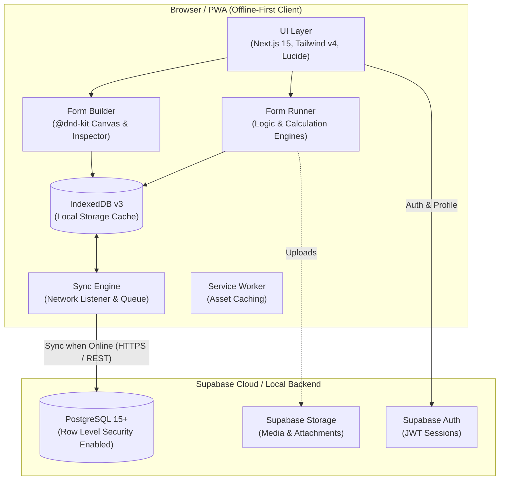

# FarmHand — Enterprise Offline Field Data Collection

[](https://nextjs.org/)
[](https://react.dev/)
[](https://www.typescriptlang.org/)
[](https://tailwindcss.com/)
[](https://supabase.com/)
[](https://developer.mozilla.org/en-US/docs/Web/API/IndexedDB_API)
[](https://developer.mozilla.org/en-US/docs/Web/Progressive_web_apps)

**FarmHand** is a modern, enterprise SaaS platform built for **offline-first field data collection, farm inspections, and agricultural campaign management**. 

Inspired by legacy field collection platforms like *Device Magic*, *KoboToolbox*, and *Fulcrum*, FarmHand re-imagines the experience with a high-performance, aesthetic interface modeled after *Linear*, *Vercel*, and *Notion*. It gives agricultural organizations, cooperatives, agronomists, and field extension officers the tools they need to gather critical field intelligence even in remote rural areas with zero internet connectivity.

---

## Table of Contents

- [Vision & Problem Statement](#vision--problem-statement)
- [Key Features](#key-features)
  - [Drag-and-Drop Form Builder](#1-drag-and-drop-form-builder)
  - [Turnkey Agricultural Templates](#2-turnkey-agricultural-templates)
  - [Offline-First Sync Engine & PWA](#3-offline-first-sync-engine--pwa)
  - [Agricultural Registry (Farmers, Farms & Fields)](#4-agricultural-registry-farmers-farms--fields)
  - [Campaign & Project Management](#5-campaign--project-management)
  - [Dynamic Form Runner & Draft Recovery](#6-dynamic-form-runner--draft-recovery)
  - [Submission Management & RFC 4180 Exports](#7-submission-management--rfc-4180-exports)
  - [Enterprise Security & Row Level Security](#8-enterprise-security--row-level-security)
- [System Architecture](#system-architecture)
- [Tech Stack](#tech-stack)
- [Directory Structure](#directory-structure)
- [Getting Started & Installation](#getting-started--installation)
  - [Prerequisites](#prerequisites)
  - [Step 1: Clone and Install Dependencies](#step-1-clone-and-install-dependencies)
  - [Step 2: Environment Variables](#step-2-environment-variables)
  - [Step 3: Database & Migrations Setup](#step-3-database--migrations-setup)
  - [Step 4: Run the Development Server](#step-4-run-the-development-server)
- [Offline Simulation & Testing](#offline-simulation--testing)
- [Automated Audit & Verification Suite](#automated-audit--verification-suite)
- [Roadmap](#roadmap)
- [License](#license)

---

## Vision & Problem Statement

Field data collection in agriculture faces unique structural constraints:
1. **Unreliable Connectivity:** Rural plots, plantations, and farms often lack cellular coverage or reliable broadband.
2. **Brittle Form Logic:** Complex agronomic forms require dynamic conditional branching, automated math calculations (yield formulas, area conversions), and validation on the fly.
3. **Data Loss & Version Skew:** Field officers lose work when sessions crash, or historical submissions become unreadable when an administrator updates the form template.
4. **Disjointed Operational Context:** Submissions are often collected in isolation without linking back to registered farmers, plots, or parent agricultural campaigns.

### How FarmHand Solves This:
- **Offline By Default:** Everything runs client-side first. You can create drafts, fill inspections, and complete surveys completely offline. Submissions are saved to local **IndexedDB** storage and synced idempotently when a network connection is detected.
- **Immutable Schema Snapshots:** Every submission captures an exact snapshot of the form schema at the time of entry. Editing a form template will never corrupt or alter historical inspection records.
- **Context-Bound Operations:** Every record can be tied directly to a **Project Campaign**, a **Registered Farmer**, a **Farm Plot**, and a specific **Field Subdivision**.

---

## Key Features

### 1. Drag-and-Drop Form Builder
Build sophisticated inspection forms visually in minutes:
- **`@dnd-kit` Powered Canvas:** Drag, reorder, sort, and clone form elements with fluid animations.
- **15+ Field Types:**
  - *Standard:* Single-line Text, Multi-line Paragraph, Number, Email, Phone, Date, Time.
  - *Choices:* Dropdown, Single-choice Radio, Multiple Checkboxes, Yes/No toggle.
  - *Field Media & Hardware:* GPS / Geolocation coordinate capture, Photo uploads, Digital Signatures, Barcode / QR Code scanners.
  - *Structure:* Section Headers, Dividers, and Repeat Groups (for recording sub-lists like livestock herds or inventory items).
- **Conditional Visibility Logic:** Show or hide fields dynamically based on responses in other fields (e.g., *Show "Pest Details" only if "Pest Detected" equals "Yes"*).
- **Real-Time Calculation Engine:** Parse and evaluate math expressions on field values in real-time (e.g., `[plot_length] * [plot_width]` or `[cultivated_area] * [yield_per_hectare]`).
- **Device Viewport Preview:** Toggle between interactive Desktop and Mobile preview frames without leaving the builder.

### 2. Turnkey Agricultural Templates
FarmHand ships with built-in production templates ready for one-click deployment:
- **Farm Inspection:** Inspects environmental conditions, crop health, pest detection, and automatic plot surface area calculation.
- **Crop Survey:** Tracks crop varieties, planting dates, phenological growth stages, and calculated total harvest yield.
- **Livestock Registration:** Employs repeat groups to record herds, species, headcounts, and vaccination statuses.
- **Field Visit Report:** Logs extension officer visits, agronomic findings, and scheduled follow-up dates.
- **Input Distribution Log:** Tracks beneficiary distribution of subsidized seeds and fertilizers with automatic value totaling.

### 3. Offline-First Sync Engine & PWA
- **IndexedDB v3 (`farmhand_offline_db`):** Stores schemas, drafts, queue items, projects, farmers, and farms locally in the browser.
- **Idempotent Background Synchronization:** Submissions generate a unique `client_submission_id` UUID client-side. The `SyncEngine` retries seamlessly upon network reconnection without creating duplicate records.
- **Service Worker & Manifest:** Offline asset caching and standalone PWA installability on mobile phones and tablets.

### 4. Agricultural Registry (Farmers, Farms & Fields)
Maintains a centralized directory of agricultural entities:
- **Farmers Registry:** Personal identification, contact numbers, national IDs, and associated farm holdings.
- **Farms & Fields:** Farm boundaries, geographical descriptions, and subdivided fields with metric area tracking (hectares/acres).
- **Relational Integrity:** Submissions inherit foreign key context to enable cross-cutting analytics across plots and farmer cohorts.

### 5. Campaign & Project Management
- Organize data collection into targeted campaigns (e.g., *"2026 Maize Inoculation Drive"*).
- Assign specific forms to projects, track completion goals against submission targets, and monitor campaign date ranges.

### 6. Dynamic Form Runner & Draft Recovery
- **Smart Validation:** Validates required fields, min/max numbers, length limits, date ranges, and regex patterns with instant visual cues and autofocus on error.
- **Auto-Draft Recovery:** Auto-saves uncompleted drafts locally; prompts users to resume unfinished inspections upon return.
- **Rich Media Support:** Local photo capture preview and coordinate resolution.

### 7. Submission Management & RFC 4180 Exports
- Filter submissions by Project, Form Template, Farmer, Farm, Field, Date Range, or Status.
- **Submission Detail Inspector:** Inspect answers, geolocation coordinates, and form schema snapshots.
- **RFC 4180 Compliant CSV Export:** Formats nested arrays, GPS coordinates, and choice values for clean spreadsheet import.
- **Raw JSON Export:** Full payload dump for GIS analysis or custom pipeline ingestion.

### 8. Enterprise Security & Row Level Security
- **Multi-Tenant Owner Isolation:** PostgreSQL Row Level Security (RLS) ensures each authenticated user strictly reads and writes their own data.
- **Hardened Database Triggers:** Automated `handle_new_user` trigger with `SECURITY DEFINER` and sanitized `search_path`.
- **Soft Deletion & Safety Rules:** Referential integrity semantics protect historical submissions when projects or forms are modified.

---

## System Architecture



---

## Tech Stack

| Domain | Technology | Purpose |
| :--- | :--- | :--- |
| **Framework** | [Next.js 15.5](https://nextjs.org/) | React Server Components, App Router, Turbopack |
| **UI Library** | [React 19](https://react.dev/) | Core UI runtime |
| **Language** | [TypeScript 5](https://www.typescriptlang.org/) | End-to-end static typing |
| **Styling** | [Tailwind CSS v4](https://tailwindcss.com/) | Modern atomic styling & design tokens |
| **Drag & Drop** | [`@dnd-kit`](https://dndkit.com/) | Drag-and-drop builder canvas and reordering |
| **Icons** | [Lucide React](https://lucide.dev/) | Clean, accessible iconography |
| **Client Storage** | IndexedDB API | High-capacity offline persistence |
| **Backend & DB** | [Supabase](https://supabase.com/) | PostgreSQL 15+, Auth, Storage, and RLS |
| **Typography** | Geist Sans & Geist Mono | High-legibility typography |

---

## Directory Structure

```text
farmhand/
├── app/                          # Next.js App Router
│   ├── globals.css               # Design tokens, CSS variables, Tailwind configuration
│   ├── layout.tsx                # App root layout with AuthProvider & AuthGuard
│   ├── page.tsx                  # Primary workspace controller & view switcher
│   ├── login/                    # Supabase authentication login screen
│   └── signup/                   # User registration screen
├── components/                   # Modular React components
│   ├── auth/                     # AuthGuard and authentication wrappers
│   ├── farmers/                  # Farmers registry list, modal, and detail views
│   ├── farms/                    # Farms & fields management views
│   ├── forms/                    # Form builder workspace, toolbar, canvas, inspector
│   ├── layout/                   # AppShell, Sidebar, Header navigation
│   ├── preview/                  # Device viewport preview components
│   ├── projects/                 # Projects & campaigns dashboard and modals
│   ├── runner/                   # Dynamic form runner, fields, and success state
│   ├── settings/                 # User profile & credentials settings
│   ├── shared/                   # MetricCard, DataTable, SearchBar, StatusBadge, Toasts
│   ├── submissions/              # Submissions data table, filters, and detail dialogs
│   ├── templates/                # Template library explorer and generator
│   └── ui/                       # Base UI primitives (buttons, inputs, dialogs)
├── form-builder/                 # Form Builder engine core
│   ├── components/               # Field renderers, inspectors, and drag-and-drop context
│   ├── registry/                 # Central field registry and validation handlers
│   ├── state/                    # Builder state machine and Context provider
│   └── types/                    # Core FormSchema and Field definitions
├── lib/                          # Core business logic & repositories
│   ├── auth/                     # AuthContext & session handling
│   ├── calculations/             # Math expression tokenizer and evaluator
│   ├── export/                   # RFC 4180 CSV & JSON export generation
│   ├── logic/                    # Conditional branching rule evaluation engine
│   ├── offline/                  # IndexedDB schema, SyncEngine, connectivity hook
│   ├── repositories/             # Abstraction layer (Local & Supabase Repositories)
│   ├── supabase/                 # Client initializer, DB types, automated audit suites
│   └── templates/                # Static agricultural starter templates
├── public/                       # Static assets, PWA manifest, service worker (sw.js)
├── supabase/                     # Supabase CLI configuration & migrations
│   └── migrations/               # Sequential SQL migrations (Milestones 13–16, Phases 2–8)
├── package.json
└── tsconfig.json
```

---

## Getting Started & Installation

### Prerequisites
- **Node.js**: `v18.18.0` or higher (Node `v20+` recommended)
- **Package Manager**: `npm`, `pnpm`, `yarn`, or `bun`
- **Supabase**: A free [Supabase](https://supabase.com/) cloud account or a local Supabase CLI instance

---

### Step 1: Clone and Install Dependencies

```bash
# Clone the repository
git clone https://github.com/thaNabstEr/farmhand.git

# Navigate into the project directory
cd farmhand

# Install dependencies
npm install
```

---

### Step 2: Environment Variables

Copy the example environment file:

```bash
cp .env.example .env.local
```

Open `.env.local` and add your Supabase credentials:

```env
# Client-side Public Supabase Credentials (Browser Safe)
NEXT_PUBLIC_SUPABASE_URL=https://your-project-ref.supabase.co
NEXT_PUBLIC_SUPABASE_ANON_KEY=your-anon-key-here

# Optional: Server-only configuration for audit suites
# SUPABASE_SERVICE_ROLE_KEY=your-service-role-key-here
```

> [!NOTE]
> Even if Supabase credentials are not initially provided, FarmHand's built-in local repositories (`LocalFormRepository` and `LocalSubmissionRepository`) will allow you to explore the Form Builder, Templates, and local form running offline in memory and IndexedDB.

---

### Step 3: Database & Migrations Setup

FarmHand includes sequential SQL migrations located in `supabase/migrations/`:

| Migration File | Milestone / Phase | Scope |
| :--- | :--- | :--- |
| `20260813000000_milestone13_database_foundation.sql` | Milestone 13 | Profiles, Farms, Fields, RLS & triggers |
| `20260813000001_milestone16_persistent_form_templates.sql` | Milestone 16 | Persistent Form Templates schema |
| `20260813000002_phase2_form_submissions.sql` | Phase 2 | Form Submissions table & RLS |
| `20260813000003_phase3_historical_data_protection.sql` | Phase 3 | Immutable Form Schema Snapshot preservation |
| `20260813000004_phase4_idempotent_sync.sql` | Phase 4 | Client Submission UUID & Idempotent sync |
| `20260817000005_phase5_submission_management.sql` | Phase 5 | Submission management, search, and delete |
| `20260817000006_phase6_farmers_registry.sql` | Phase 6 | Farmers Registry table & farm relationships |
| `20260903000007_phase8_projects.sql` | Phase 8 | Projects, Campaigns, Project-Form junctions |

#### Option A: Using the Supabase CLI (Recommended)
```bash
# Start local Supabase container (requires Docker)
npx supabase start

# Apply all migrations
npx supabase db reset
```

#### Option B: Using the Supabase Web Dashboard
1. Open your Supabase project at [app.supabase.com](https://app.supabase.com).
2. Go to the **SQL Editor**.
3. Run each SQL migration file from `supabase/migrations/` in numerical order from `000000` to `000007`.

---

### Step 4: Run the Development Server

```bash
npm run dev
```

Open [http://localhost:3000](http://localhost:3000) in your browser.

- Sign up for a new account at `/signup` or log in at `/login`.
- You will be redirected to the **FarmHand Dashboard**.

---

## Offline Simulation & Testing

You can verify FarmHand's offline capabilities directly in your browser:

1. Open FarmHand in Google Chrome or Microsoft Edge.
2. Open **Chrome DevTools** (`F12` or `Cmd + Option + I`).
3. Switch to the **Network** tab and select **"Offline"** in the throttling dropdown.
4. Notice the **Live Sync Badge** in the top navigation bar turn amber: `Offline (Queue Active)`.
5. Navigate to **Forms**, choose a template (e.g. *Farm Inspection*), and fill out a submission.
6. Click **Submit Inspection**. The record is saved directly to **IndexedDB**.
7. Go to the **Submissions** tab to view your saved draft/submission with a `Pending Sync` status.
8. Switch the Network tab back to **"No throttling"** (Online).
9. The `SyncEngine` automatically detects connectivity, flushes the queue, synchronizes with Supabase, and updates the status to **Synced**!

---

## Automated Audit & Verification Suite

FarmHand includes an automated regression audit suite that validates Row Level Security, idempotent sync, schema snapshot integrity, and multi-tenant isolation against live or local Supabase instances.

To run the audit suite:

```bash
npx tsx lib/supabase/runSuite.ts
```

The script runs audits sequentially:
- **Phase 2 Audit:** Submission persistence & RLS ownership.
- **Phase 3 Audit:** Historical schema snapshot immutability.
- **Phase 4 Audit:** Idempotent client submission deduplication.
- **Phase 5 Audit:** Submission management, deletion, and filtering.
- **Phase 6 Audit:** Farmer registry isolation & offline store integrity.
- **Phase 7 Audit:** Data stabilization and recovery.
- **Phase 8 Audit:** Projects & campaign operations junction validation.

---

## Roadmap

- [x] Visual Drag-and-Drop Form Builder with `@dnd-kit`
- [x] Client-side conditional logic & mathematical expression evaluators
- [x] IndexedDB v3 offline persistence & automatic background sync
- [x] Immutable form schema snapshot preservation
- [x] Agricultural Registry (Farmers, Farms, Fields)
- [x] Campaign & Project Operations Foundation
- [x] RFC 4180 CSV and JSON data export
- [ ] **Geospatial Plot Polygon Mapping:** Mapbox / OpenStreetMap integration for drawing parcel boundaries.
- [ ] **Background Sync API:** Native Service Worker background sync when browser tabs are closed.
- [ ] **Hardware Bluetooth Telemetry:** Direct connection to soil moisture probes, portable weather stations, and RFID livestock scanners.

---

## License

This project is licensed under the [MIT License](LICENSE).
